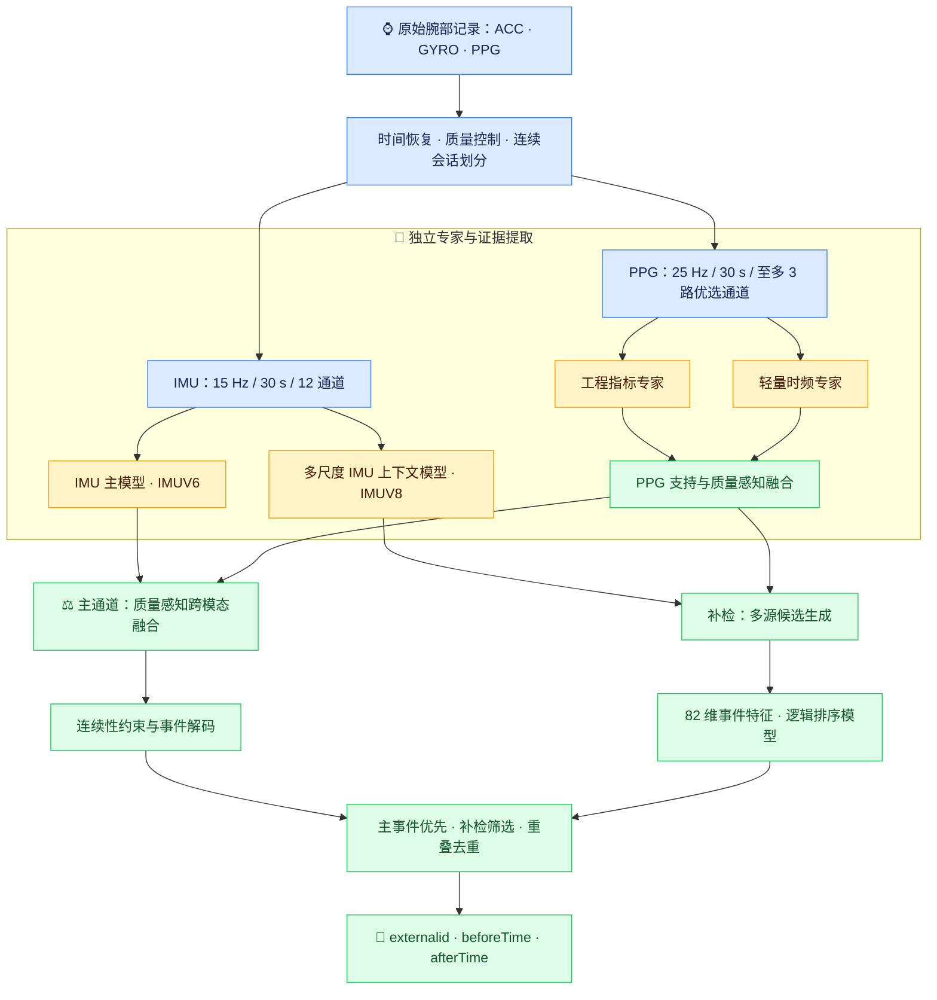
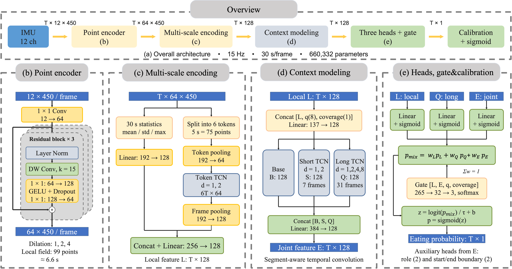
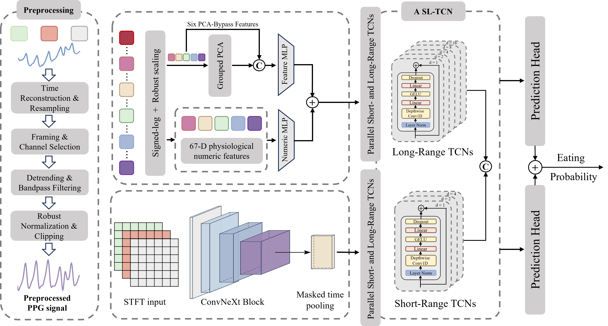

<a id="top"></a>

<div align="center">

# ⌚ METExpert

### 基于六轴 IMU 与 PPG 特征融合的智能手表进食检测系统

**从连续腕部信号，到可分析的进食时间轴。**

<p>
  
  
  
  
</p>

**🧠 多尺度动作建模 · 💓 光学双专家 · ⚖️ 质量感知融合 · 🎯 事件级补检**

[项目简介](#overview) · [系统架构](#architecture) · [实验结果](#results) · [代码导览](#structure) · [环境构建](#environment) · [训练](#training) · [推理](#inference)

</div>

---

<a id="overview"></a>

## 🌟 项目简介

METExpert 面向智能手表的连续进食检测：输入腕部加速度、角速度与光电容积脉搏波（PPG）记录，输出每次进食的**开始时间与结束时间**，为餐次统计、进餐时长分析和饮食规律研究提供结构化数据。

日常活动中的抬手、饮水与整理物品可能产生相似运动；佩戴于非进食手时，动作证据也可能较弱。项目将 **IMU 的运动行为线索**与 **PPG 的脉搏、波形和时频线索**相结合，根据实际信号质量与有效覆盖调整证据贡献，再通过事件级筛选控制误报与漏检。

| 设计重点 | 项目中的实现 |
| :--- | :--- |
| 🧭 尊重真实时间 | 恢复绝对时间轴，保留缺口、有效性掩码和连续段标识 |
| 🦾 兼顾动作与上下文 | 12 通道惯性输入，结合局部动作、帧内片段顺序与长短时序 |
| 💓 保留互补光学信息 | 工程指标专家与轻量时频专家独立学习、按支持与质量融合 |
| ⚖️ 感知模态可用性 | 融合分数、表征、质量和覆盖信息，支持单模态缺失时的预测 |
| 🎯 直接输出事件 | 主通道检测与补检候选排序相结合，输出起止时间 CSV |
| 📦 提供完整运行入口 | 统一 CLI、五组件权重、权重校验及 Windows 启动器 |

<a id="architecture"></a>

## 🏗️ 系统架构

系统采用 **「主通道融合检测 + 事件级补检」** 的两阶段结构。IMU 主模型与 PPG 专家构成主通道；多尺度 IMU 上下文模型与同一套 PPG 专家提供补检证据。各分支在统一时间轴上交换预测、特征、质量及支持信息。



### 01 · 🧹 多模态预处理

预处理以**受试者与物理连续会话**为单位进行，先恢复采样时刻，再完成单位换算、滤波与重采样。有效性掩码和连续段标识贯穿特征提取、时序传播与事件解码，使真实信号断档能够被显式处理。

| 路径 | 采样与分帧 | 输入表示 | 质量与支持信息 |
| :--- | :--- | :--- | :--- |
| **IMU** | 15 Hz；30 秒/帧；450 点/帧 | 三轴加速度 + 三轴角速度 + 三轴重力 + 三轴线性加速度，共 12 通道 | 点级有效掩码、8 项帧级质量统计、连续段标识 |
| **PPG** | 25 Hz；30 秒/帧；750 点/通道 | 从候选光学通道中按质量选择至多 3 路，构造工程指标与数值时频谱 | 通道与波长信息、信号质量、波形及特征覆盖率 |

### 02 · 🦾 IMU Expert：多视图、多尺度动作建模

<p align="center">
  <a href="asset/IMUExpert.png">
    
  </a>
  <br>
  <sub>IMU 多尺度上下文专家结构 · 点击查看原始高清图</sub>
</p>

图中多尺度结构对应当前代码的 **`IMUV8Model`**（`_core/context_encoder/model.py`），用于事件补检的运动证据提取。主通道另使用 **`IMUV6Model`**（`_core/motion_encoder/model.py`），两者共享 12 通道多视图输入与局部运动编码思路。

1. **点级局部编码**：每帧 `12 × 450` 输入经 `1 × 1` 卷积映射到 64 通道，再经过 3 个膨胀残差块，学习短时腕部动作。
2. **并行多尺度编码**：整帧分支汇聚均值、标准差和最大值；有序片段分支将 30 秒划分为 6 个连续 5 秒 token，经 token TCN 连接邻近动作。两路共同形成 128 维局部表征。
3. **长短上下文建模**：局部表征与 8 维质量统计、覆盖率共同输入时序模块。短分支膨胀率为 `1, 2`，长分支为 `1, 2, 4, 8`；时序信息仅在有效连续段内传播。
4. **三头概率门控**：局部、长时上下文与联合预测头分别输出进食概率，门控网络根据表征和质量生成归一化权重，自适应组合三路证据。
5. **辅助监督与接口**：手别和起止边界任务辅助训练；推理输出进食概率、边界分数、128 维表征及支持信息，手别信息由模型预测。

> 📐 图中的 `T` 表示 30 秒帧序列长度。当前默认 `IMUV8Model` 含 **660,330 个参数**；图示用于说明结构，精确参数及前向行为以代码为准。温度与偏置校准由下述跨模态融合模块实现。

### 03 · 💓 PPG Expert：工程指标 × 轻量时频

<p align="center">
  <a href="asset/PPGExpert.png">
    
  </a>
  <br>
  <sub>PPG 双专家结构 · 工程指标与时频表示分别学习，再按有效支持融合</sub>
</p>

PPG 路径由两个能够**独立预测**的专家组成，对应 `_core/signals/optical/model_v9.py`。

| 模块 | 工程指标专家 | 轻量时频专家 |
| :--- | :--- | :--- |
| 输入 | 多尺度生理与波形描述、缺失掩码、覆盖信息 | 优选 PPG 通道的 STFT 数值谱、通道与波长信息 |
| 表征 | 稳健缩放、分组 PCA、关键指标直通、数值残差 MLP | ConvNeXt V2 风格编码器、掩码感知归一化与质量汇聚 |
| 时间建模 | 独立的短、长时序 TCN | 独立的短、长时序 TCN |
| 预测接口 | 进食概率、起止边界、可靠性与有效支持 | 进食概率、起止边界、可靠性与有效支持 |
| 训练方式 | 独立监督、EMA 与最佳快照 | 独立监督、EMA 与最佳快照，附加生理指标重建 |

**工程指标专家。** 当前固定输入为 **68 列：67 项生理/波形数值 + 1 项历史覆盖可靠性**。指标覆盖脉率与时间域变异、频域变异、庞加莱与复杂性、形态及光学比值、波形频谱五个特征族。分组 PCA 保留 95% 训练方差；6 项关键指标直接保留，67 项数值另经残差旁路补充细节。PCA 与缩放统计量仅由训练受试者拟合。

**轻量时频专家。** 每路 30 秒 PPG 构造 `37 × 23` 数值谱：STFT 使用 200 点窗、25 点步长，并保留 `0.5–5 Hz` 频带。三级编码宽度为 `24 → 48 → 96`，沿频率方向下采样，保留帧内时间结构；随后汇聚为 64 维逐帧表征。两专家均使用短分支 `1, 2, 4` 与长分支 `1, 2, 4, 8, 16` 的膨胀时序卷积。

**支持感知融合。** 两专家按先验权重、有效支持与信号质量组合概率；缺失路径退出权重归一化，所有路径均无支持时保留无支持状态。已提供 PPG 权重的先验为**工程指标 0.3 / 时频 0.7**，逐帧实际权重还受支持和质量修正影响。

### 04 · ⚖️ 跨模态融合与事件补检

**主通道：学习如何组合运动与光学证据。** IMU 的 128 维表征和 PPG 的 64 维表征分别投影为 16 维，再与预测分数、质量、覆盖率、手别预测及两模态分歧一起送入门控网络。两路 logit 经温度与偏置校准后加权，得到点级融合概率；只有一个模态可用时，权重分配给该模态，两路均缺失的位置不生成事件。

**补检通道：在事件层面寻找遗漏餐次。** 多尺度 IMU 与 PPG 分别产生候选区间，为每个候选提取 **82 维特征**，包括分数统计、覆盖率、边界证据、区间形态，以及前后 2 分钟和 5 分钟的背景变化。轻量逻辑模型预测事件存在性与区间质量，形成排序分数。

**合并输出：主事件优先，补检有约束。** 保留主通道事件的边界和分数，再按排序结果加入补检候选；通过时间交并比（IoU）和相对于较短区间的重叠比例（IoS）剔除重复事件。

| 当前发布规则 | 设置 |
| :--- | :--- |
| 主通道高 / 低阈值 | `0.50 / 0.20` |
| 主通道常规最短时长 / 合并间隔 | `450 s / 60 s` |
| 强证据短事件规则 | 至少 `300 s`，高分占比至少 `0.50`，高分累计至少 `30 s` |
| 补检候选高 / 低阈值 | `0.40 / 0.15` |
| 补检候选最短时长 / 合并间隔 | `90 s / 60 s` |
| 补检排序分数阈值 | `0.50` |
| 去重条件 | `IoU > 0.50` 或 `IoS ≥ 0.80` |

> 🔎 主通道规则来自 `weights/manifest.json`；补检规则来自 `weights/event_ranker.pt`。PPG 内部专家融合另有冻结配置。训练配置与已发布 checkpoint 的设置可能存在差异，实际推理读取所选权重中的配置。

<a id="results"></a>

## 📊 实验结果

实验采用**按受试者划分**的训练、验证与留出集，人数为 **28 / 6 / 6**。留出集包含 **6 人、36 餐**；事件匹配采用 **严格 `IoU > 0.25` 的一对一匹配**。

<div align="center">

| 事件 F1 | 精确率 | 召回率 | 正确检出 / 误报 / 漏检 |
| :---: | :---: | :---: | :---: |
| **0.6567** | **70.97%** | **61.11%** | **22 / 9 / 14** |

</div>

| 定位指标 | 实验结果 | 统计范围 |
| :--- | :---: | :--- |
| 进食开始时间 MAE | **189.58 s** | 22 个正确匹配事件 |
| 进食结束时间 MAE | **109.42 s** | 22 个正确匹配事件 |

补检对照实验显示，加入事件级补检后，正确检出由 **18 餐增加到 22 餐**，误报由 **6 次变为 9 次**，事件 F1 由 **0.6000 提高到 0.6567**。PPG 独立五折实验覆盖 40 名受试者、261 餐与 1364.75 小时光学观测，合并事件 F1 为 **0.4283**；该结果使用不同评价划分，需与系统留出成绩分别理解。

> 📝 原始数据和训练标注需自行准备；本仓库的权重自检验证完整性与模型前向计算，完整指标复现还需相同的数据、标注和评价流程。当前 PPG 配置使用非因果时序上下文，运行方式为连续记录上的离线检测。

<a id="structure"></a>

## 🗂️ 代码导览

```text
METExpert/
├── README.md                       # 项目说明与运行指南
├── run.py                          # 统一命令入口
├── Competition2.exe                # Windows 环境引导与推理启动器
├── requirements.txt                # 源码运行依赖
├── asset/                          # 透明底原始流程图
├── configs/
│   ├── split.json                  # 按受试者划分的数据集配置
│   └── training.json               # 全流程训练参数与解码规则
├── src/eatdet/
│   ├── cli.py                      # annotations / preprocess / train / predict / check
│   ├── annotations.py              # 官方餐次表转换与监督策略
│   ├── preprocess.py               # 原始记录 → IMU 帧 / PPG 缓存
│   ├── training.py                 # 五组件训练与权重导出
│   └── inference.py                # 证据构建、融合、事件输出与权重自检
├── _core/
│   ├── sensor_io/                  # 物理传感器读取与缓存
│   ├── data_pipeline/              # 连续会话与多模态数据组织
│   ├── motion_encoder/             # IMUV6：主通道 IMU 模型
│   ├── context_encoder/            # IMUV8：多尺度 IMU 上下文模型
│   ├── primary_fusion/             # 主通道质量感知融合
│   ├── event_detection/            # 候选生成、82 维事件特征与排序
│   ├── event_metrics/              # 事件匹配、F1 与边界误差
│   └── signals/                    # 信号预处理、光学专家与赛事输入输出接口
├── weights/                        # 五个模型组件及 SHA-256 清单
├── environment/                    # Windows 锁定依赖与引导配置
├── launcher/                       # PowerShell 引导与启动器源码
├── tests/                          # 预处理、训练及推理测试
└── licenses/                       # 第三方许可
```

| 权重文件 | 对应组件 |
| :--- | :--- |
| `weights/imu_primary.pt` | 主通道 IMU 运动模型 |
| `weights/imu_context.pt` | 多尺度 IMU 上下文模型 |
| `weights/ppg.pt` | PPG 双专家、特征变换与光学后处理配置 |
| `weights/primary_fusion.pt` | 质量感知跨模态门控与校准 |
| `weights/event_ranker.pt` | 事件排序模型、补检候选与去重配置 |

第三方组件说明见 [THIRD_PARTY_NOTICES.md](THIRD_PARTY_NOTICES.md)。

---

<a id="environment"></a>

## 🛠️ 环境构建

以下命令均在**项目根目录**执行。Windows 示例使用 PowerShell；源码环境与启动器锁定环境是两种独立安装方式。

### 方式 A · Windows 自动构建与自检

适合使用已提供权重进行 CPU 推理。保持完整项目目录，运行：

```powershell
.\Competition2.exe --check-only --no-pause
```

启动器依据 `environment/bootstrap.json` 和 `environment/requirements.lock`，下载指定 Python、创建本地 `.venv`、安装带哈希校验的 CPU 依赖，并执行五组件模型自检。首次构建需要联网，日志保存在 `logs/bootstrap.log`。

仅需直接调用引导脚本时，可使用：

```powershell
powershell -NoProfile -ExecutionPolicy Bypass -File .\launcher\bootstrap.ps1 -Root . -CheckOnly
```

### 方式 B · 手动创建源码环境

使用已安装的 **64 位 Python 3.11** 创建独立环境：

```powershell
python -m venv .venv-dev
.\.venv-dev\Scripts\Activate.ps1
python -m pip install --upgrade pip
python -m pip install -r requirements.txt
```

Linux 对应的环境创建与激活命令为 `python3.11 -m venv .venv-dev`、`source .venv-dev/bin/activate`，之后使用相同的 `python -m pip` 和 `python run.py` 命令。

源码依赖固定为：

| 依赖 | 版本 | 用途 |
| :--- | :--- | :--- |
| PyTorch | `2.8.0` | 模型训练与推理 |
| NumPy / SciPy | `2.2.6` / `1.15.3` | 数值计算与信号处理 |
| pandas / h5py | `2.3.3` / `3.16.0` | 表格读取与中间数据存储 |
| imufusion / threadpoolctl | `1.3.3` / `3.6.0` | 姿态处理与线程控制 |

需要 NVIDIA GPU 训练时，可在此源码环境中安装 CUDA 12.8 对应的 PyTorch 2.8.0 构建：

```powershell
python -m pip install --upgrade --force-reinstall --no-deps torch==2.8.0 --index-url https://download.pytorch.org/whl/cu128
python -c "import torch; print('PyTorch:', torch.__version__); print('CUDA:', torch.cuda.is_available()); print('BF16:', torch.cuda.is_bf16_supported() if torch.cuda.is_available() else False)"
```

该版本的 CUDA 构建选项见 [PyTorch 官方历史版本安装说明](https://pytorch.org/get-started/previous-versions/#v280)。默认训练配置开启 AMP，CUDA 训练要求设备支持 **BF16**；若不支持，可复制 `configs/training.json` 并将顶层及 `ppg.training.amp` 设为 `false`，通过 `--config` 指定新配置。

安装完成后，检查依赖和已提供权重：

```powershell
python -m pip check
python run.py check --weights ./weights
```

成功时输出包含 `"passed": true`、`"weight_hashes_verified": true` 与 `"forward_checks": 5`。

<a id="data"></a>

## 🗃️ 数据准备与预处理

### 原始记录目录

将官方格式 TXT 记录按受试者放置在数据根目录的直接子目录中，例如：

```text
ACC_train_data/
├── HNU21001/
│   ├── collect_data0_....txt
│   └── collect_data1_....txt
├── HNU21004/
│   └── collect_data0_....txt
└── ...
```

训练数据、测试数据与餐次表需自行提供。下文 `data/meals.csv` 为示例路径，请替换为实际文件；自定义数据也应按当前赛事 TXT 格式组织，并更新人员划分配置。

### ① 转换训练标注

```powershell
python run.py annotations --meals ./data/meals.csv --data-root ./ACC_train_data --output-dir ./.work/annotations
```

餐次表需要 `uniqueid`、`externalid`，以及 `timeFrame` 或 `beforeTime` / `afterTime` 起止字段。转换优先使用 `timeFrame` 中的 `startTime` / `endTime`；佩戴手与进食手字段可提供辅助监督。额外用户表和补充餐次表分别通过 `--users`、`--secondary` 指定。

输出包含 `events.csv`、`event_metadata.jsonl`、`policy.json`、`unknown_intervals.csv` 与转换审计信息。

### ② 构建训练缓存

```powershell
python run.py preprocess --data-root ./ACC_train_data --work-dir ./.work/train_prepared --annotations ./.work/annotations --split ./configs/split.json --workers 4 --preprocess-workers 1 --device-workers 1
```

完成后得到 `prepared.json`、`imu/manifest.json` 与 `native/ppg/` 等缓存。`--work-dir` 必须位于原始数据目录之外；缓存记录了数据、标注与划分指纹，输入发生变化时应使用新的工作目录。

> 🧩 `configs/split.json` 中的 `train`、`val`、`test` 必须按人员互斥，训练和验证列表均需非空。准备的数据人员应包含在划分中；共享原始来源的人员组须归入同一集合。推理预处理可省略 `--annotations` 与 `--split`。

<a id="training"></a>

## 🚀 模型训练

### 全流程训练

```powershell
python run.py train --prepared ./.work/train_prepared --output-dir ./training_output/run01 --config ./configs/training.json --device cuda:0 --workers 2
```

统一入口依次完成 **PPG 双专家 → IMU 主模型 → 主通道融合 → IMU 上下文折外/完整训练 → 事件排序模型**，最终导出与已提供权重相同的五组件目录。上下文折外预测用于构建排序训练证据；该阶段的 PPG 为冻结模型，代码将此证据标记为 `imu_oof=True`、`ppg_oof=False`。

| 组件 | 当前默认训练预算与关键设置 |
| :--- | :--- |
| PPG 双专家 | 最多 70 轮主训练 + 10 轮微调；batch 8；学习率 `1.5e-4`；192 帧输入 / 128 帧核心 |
| IMU 主模型 | 23 轮；batch 8；学习率 `3e-4`；48 帧输入 / 16 帧核心 |
| IMU 上下文模型 | 4 折预算 `8 / 8 / 6 / 7` 轮；全训练集重训 8 轮 |
| 主通道融合 | 1 轮；batch 16；学习率 `1e-3` |
| 事件排序模型 | 30 轮；逻辑模型；82 维输入 |

输出结构：

```text
training_output/run01/
├── training_config.json       # 本次实际训练配置
├── training/                  # 光学及上下文训练过程文件
├── weights/
│   ├── imu_primary.pt
│   ├── imu_context.pt
│   ├── ppg.pt
│   ├── primary_fusion.pt
│   ├── event_ranker.pt
│   └── manifest.json          # 新权重哈希与事件解码规则
└── complete.json              # 完成记录与训练摘要
```

训练完成后检查导出权重：

```powershell
python run.py check --weights ./training_output/run01/weights
```

### 🧪 小规模集成训练

先验证数据和各训练组件能否串联，可运行 CPU 冒烟训练：

```powershell
python run.py train --prepared ./.work/train_prepared --output-dir ./training_output/smoke01 --config ./configs/training.json --device cpu --workers 0 --smoke
```

`--smoke` 缩减训练轮次与批次数，仍需有效标注、训练/验证人员，以及可供排序学习的正负候选；产生的权重用于流程验证。每次训练请使用新的输出目录，当前入口会拒绝覆盖已有训练结果。

<details>
<summary><b>♻️ 复用 PPG 权重，仅训练其余组件</b></summary>

```powershell
python run.py train --prepared ./.work/train_prepared --output-dir ./training_output/reuse_ppg01 --config ./configs/training.json --device cuda:0 --workers 2 --ppg-checkpoint ./weights/ppg.pt
```

入口会检查 PPG checkpoint 中 PCA 的拟合人员与本次训练人员完全一致；自定义划分不能直接复用不匹配的特征变换。

</details>

<a id="inference"></a>

## 🔎 推理与结果输出

### 方式 1 · 从原始 TXT 直接预测

```powershell
python run.py predict --data-root ./ACC_test_data --work-dir ./.work/test_prepared --weights ./weights --output ./results.csv --device cpu --batch-size 8
```

命令自动完成预处理、五组件推理、事件融合与 CSV 输出。已有可用 CUDA 环境时，将 `--device cpu` 改为 `--device cuda:0`。

### 方式 2 · 复用预处理缓存

```powershell
python run.py preprocess --data-root ./ACC_test_data --work-dir ./.work/test_prepared --workers 4
python run.py predict --prepared ./.work/test_prepared --weights ./weights --output ./results.csv --device cpu --batch-size 8
```

`--prepared` 可指向缓存目录或其中的 `prepared.json`；与 `--data-root` 二选一。预测指定人员时，可添加 `--people HNU21002,HNU21003`。

使用自己训练的模型时，切换权重目录：

```powershell
python run.py predict --prepared ./.work/test_prepared --weights ./training_output/run01/weights --output ./results_run01.csv --device cuda:0 --batch-size 8
```

### 方式 3 · Windows 启动器

将数据放入项目根目录的 `ACC_test_data/` 后运行：

```powershell
.\Competition2.exe --no-pause
```

启动器执行环境检查、模型自检及 CPU 推理，默认生成根目录的 `results.csv`。

### 📄 输出格式

```csv
externalid,beforeTime,afterTime
HNU21002,1760000000000,1760000600000
```

示例仅说明格式：`externalid` 为受试者编号，`beforeTime`、`afterTime` 为 **13 位 Unix 毫秒时间戳**。每行对应一个进食事件，结果按人员和时间排序；无事件时仅输出表头。程序先验证临时 CSV，再原子替换目标文件。

### 🧰 常用检查命令

```powershell
# 查看统一入口与各子命令参数
python run.py --help
python run.py preprocess --help
python run.py train --help
python run.py predict --help

# 检查已提供模型的哈希及五组件前向计算
python run.py check --weights ./weights
```

运行源码测试时，需要同时将 `src` 与 `_core` 加入模块路径：

```powershell
$env:PYTHONPATH = "$PWD/src;$PWD/_core"
python -m unittest discover -s tests -v
```

<details>
<summary><b>🐧 Linux 测试命令</b></summary>

```bash
PYTHONPATH=src:_core python -m unittest discover -s tests -v
```

</details>

<div align="center">

---

**⌚ 感知腕部动作 · 💓 理解光学变化 · 🍽️ 记录每一次进食**

[回到顶部](#top) · [训练配置](configs/training.json)

</div>
